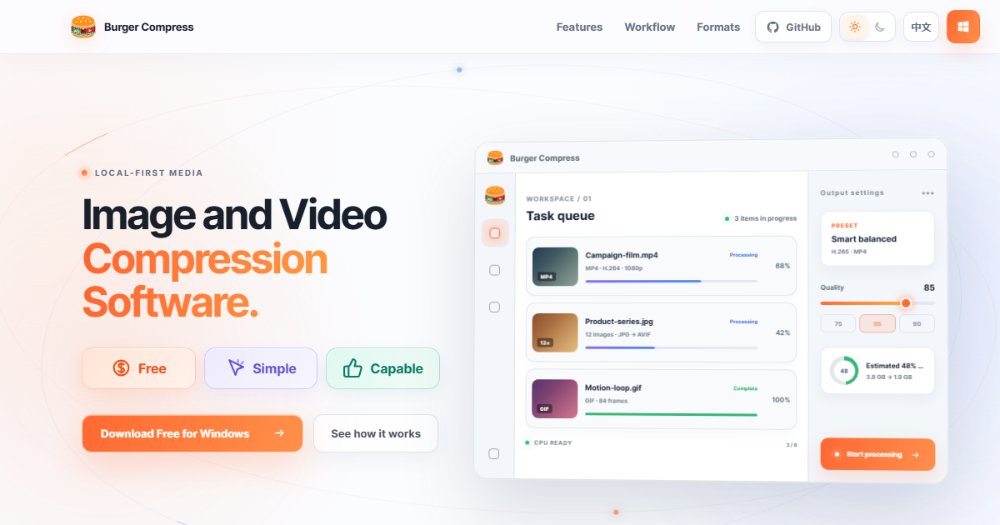

<h1 align="center">Burger Compress · 汉堡压缩</h1>

  <strong>Free, simple, and capable image and video compression software.</strong>

  <a href="https://burgercompress.visionular.net/?lang=en"><strong>Official Website</strong></a> ·
  <a href="https://burgercompress.visionular.net/download/windows"><strong>Download for Windows</strong></a> ·
  <a href="CHANGELOG.md">What's new</a> ·
  <a href="SUPPORT.md">Support</a> ·
  <a href="#简体中文">简体中文</a>

## Compress images and videos, your way

Burger Compress is a free desktop app for batch image and video compression and format conversion. Choose an official preset to get started, or adjust advanced settings and create personal templates for repeatable work.

Media processing runs on your computer. Your source media, thumbnails, file paths, processing history, and output files are not uploaded to Burger Compress servers.

### Free. Simple. Capable.

- **Free:** process local images and videos without signing in.
- **Simple:** add files, choose a preset, and start. Follow progress and results in one task queue.
- **Capable:** adjust quality, output formats, and supported advanced settings; save personal templates for recurring tasks.
- **Image size control:** use quality settings or a target file size for supported image workflows.
- **Batch workflow:** handle multiple files, review processing status, and open completed outputs.
- **Optional account features:** sync personal templates and send feedback from About. Media files are not part of template sync.
- **Two interface languages:** English and Simplified Chinese.

## Download for Windows

[**Download the latest stable installer →**](https://burgercompress.visionular.net/download/windows)

Current stable release: **1.0.9**, published **November 26, 2026** for **Windows 11 x64**.

[**Download 1.0.9 from GitHub**](https://github.com/visionular/BurgerCompress/releases/download/v1.0.9/Burger-Compress-1.0.9-Setup-x64.exe) · [View the GitHub release](https://github.com/visionular/BurgerCompress/releases/tag/v1.0.9)

| Release detail | Value |
| --- | --- |
| Installer | `Burger-Compress-1.0.9-Setup-x64.exe` |
| Size | 118,167,304 bytes (112.7 MiB) |
| Digital signature | Timestamped Authenticode signature |
| Publisher | `杭州微帧信息科技有限公司` |
| SHA-256 | `33DCB596B687E2B65957E281CBCED592A0D0B2814EEEA3332989D4810A653E01` |

### New in 1.0.9

- Send supported images and videos directly to compression from the Windows context menu.
- Filter, sort, and navigate large media lists more smoothly.
- Pause and resume tasks in batches, and open the output folder from the import page or Settings.
- Resolves several known issues.

See the bilingual [release notes](CHANGELOG.md).

## Get started

1. **Add files.** Import one or more images or videos.
2. **Choose your settings.** Select an official preset and output format. Adjust quality or supported advanced options when needed.
3. **Start processing.** Choose the output location, run the task, and open the result. Source files are not overwritten by default.

## Supported input formats

| Type | Recognized source formats |
| --- | --- |
| Video | MP4, MKV, MOV, M4V, AVI, FLV, M2TS, MTS, TS, 3GP, 3G2 |
| Image | JPG, JPEG, WEBP, AVIF, HEIC, HEIF, PNG, APNG, BMP, TIF, TIFF, GIF |

This is an **input-format list**, not a promise that every format can be exported. Available outputs, codecs, filters, and hardware acceleration depend on the source media and the capabilities detected on your computer. Target file-size control is offered for supported image workflows.

## Privacy, accounts, and feedback

Local media processing does not require an account. Sign in to sync personal templates or send in-app feedback. Template sync does not include media files, thumbnails, local file paths, or processing history. One account supports up to five active devices.

- **Product suggestions:** open **About → Feedback** in the app, or use [GitHub Issues](https://github.com/visionular/BurgerCompress/issues/new/choose).
- **Reproducible bugs:** follow the [support checklist](SUPPORT.md); remove private content from screenshots and logs.
- **Account or privacy requests:** email [info@visionular.com](mailto:info@visionular.com).
- **Security vulnerabilities:** follow [SECURITY.md](SECURITY.md), not a public issue.

[Privacy Notice](https://burgercompress.visionular.net/privacy?lang=en) · [Terms of Service](https://burgercompress.visionular.net/terms?lang=en) · [EULA](https://burgercompress.visionular.net/eula?lang=en)

## About this repository

This is the official public distribution and support repository for Burger Compress. Repository archives contain product information, release notes, and user documentation. Get the official Windows installer from the website or the **Assets** section of the [GitHub release](https://github.com/visionular/BurgerCompress/releases/tag/v1.0.9).

Burger Compress is free to use but is **proprietary, closed-source software**. Free use does not grant an open-source license. Unless applicable law or written authorization from Visionular permits otherwise, you may not copy, modify, reverse engineer, repackage, redistribute, sublicense, or resell the application or its components.

Copyright © Visionular. All rights reserved.

---

## 汉堡压缩

**汉堡压缩：免费、简单、好用的图片与视频压缩软件。**

[**官方网站**](https://burgercompress.visionular.net/) · [**下载 Windows 版**](https://burgercompress.visionular.net/download/windows) · [更新日志](CHANGELOG.md) · [支持说明](SUPPORT.md) · [English](#english)

### 图片与视频，轻松压缩，灵活调整

汉堡压缩是一款免费的桌面软件，支持批量压缩和转换图片、视频。选择官方模板即可开始；需要精细控制时，也可以调整高级参数，创建自己的模板。

媒体处理在你的电脑上完成。源文件、缩略图、文件路径、处理历史和输出文件不会上传到汉堡压缩服务器。

### 免费、简单、好用

- **免费：** 无需登录，即可处理本机的图片与视频。
- **简单：** 添加文件、选择模板、开始处理，进度与结果在任务队列中清晰展示。
- **好用：** 按需调整质量、输出格式和受支持的高级参数，把常用配置保存为个人模板。
- **图片体积控制：** 支持质量调节，并在受支持的图片流程中设置目标文件大小。
- **批量处理：** 一次处理多个文件，查看任务状态，直接打开处理结果。
- **可选账户功能：** 登录后同步个人模板，并在“关于”中发送反馈；模板同步不包含媒体文件。
- **中英双语：** 提供简体中文和英文界面。

### 下载 Windows 版

[**下载最新稳定版安装程序 →**](https://burgercompress.visionular.net/download/windows)

当前稳定版本为 **1.0.9**，于 **2026 年 11 月 26 日**发布，支持 **Windows 11 x64**。

[**从 GitHub 下载 1.0.9**](https://github.com/visionular/BurgerCompress/releases/download/v1.0.9/Burger-Compress-1.0.9-Setup-x64.exe) · [查看 GitHub 发行页](https://github.com/visionular/BurgerCompress/releases/tag/v1.0.9)

| 版本信息 | 内容 |
| --- | --- |
| 安装程序 | `Burger-Compress-1.0.9-Setup-x64.exe` |
| 文件大小 | 118,167,304 字节（112.7 MiB） |
| 数字签名 | 带时间戳的 Authenticode 签名 |
| 发布者 | `杭州微帧信息科技有限公司` |
| SHA-256 | `33DCB596B687E2B65957E281CBCED592A0D0B2814EEEA3332989D4810A653E01` |

### 1.0.9 更新内容

- 通过 Windows 右键快捷菜单，将支持的图片和视频直接送入压缩流程。
- 优化大批量媒体列表的筛选、排序和切页。
- 支持批量暂停和继续任务，并可从导入页或设置页直接打开保存文件夹。
- 解决了一些已知问题。

完整双语说明见[更新日志](CHANGELOG.md)。

### 三步开始

1. **添加文件：** 导入一张或多张图片、一段或多段视频。
2. **选择设置：** 选择官方模板和输出格式，按需调整质量或受支持的高级选项。
3. **开始处理：** 选择输出位置，运行任务并打开结果。默认不覆盖源文件。

### 支持识别的输入格式

| 类型 | 支持识别的源格式 |
| --- | --- |
| 视频 | MP4、MKV、MOV、M4V、AVI、FLV、M2TS、MTS、TS、3GP、3G2 |
| 图片 | JPG、JPEG、WEBP、AVIF、HEIC、HEIF、PNG、APNG、BMP、TIF、TIFF、GIF |

以上是**输入格式列表**，不代表所有格式均可导出。实际可用的输出格式、编码器、滤镜和硬件加速，取决于源媒体及当前电脑检测到的能力。目标文件大小功能适用于受支持的图片处理流程。

### 隐私、账户与反馈

本地媒体处理无需账户。同步个人模板或发送应用内反馈时需要登录；模板同步不包含媒体文件、缩略图、本地路径和处理历史。一个账户最多支持五台活跃设备。

- **产品建议：** 在软件的**关于 → 留言与反馈**中提交，或使用 [GitHub Issues](https://github.com/visionular/BurgerCompress/issues/new/choose)。
- **可复现的问题：** 参考[支持说明](SUPPORT.md)，先对截图和日志进行脱敏。
- **账户或隐私请求：** 邮件联系 [info@visionular.com](mailto:info@visionular.com)。
- **安全漏洞：** 按[安全说明](SECURITY.md)私下报告，不提交公开 Issue。

[隐私说明](https://burgercompress.visionular.net/privacy) · [服务条款](https://burgercompress.visionular.net/terms) · [软件许可协议](https://burgercompress.visionular.net/eula)

### 关于本仓库

这是 Burger Compress（汉堡压缩）的官方公开分发与支持仓库。仓库归档包含产品介绍、更新记录和使用说明。可从官网或 [GitHub 发行页](https://github.com/visionular/BurgerCompress/releases/tag/v1.0.9)的 **Assets** 区域获取正式 Windows 安装包。

汉堡压缩可以免费使用，但属于 **专有闭源软件**。免费使用不等于授予开源许可。除非适用法律或 Visionular 的书面授权另有允许，不得复制、修改、逆向工程、重新打包、再分发、转授权、转售本软件或其组成部分。

版权所有 © Visionular。保留所有权利。
